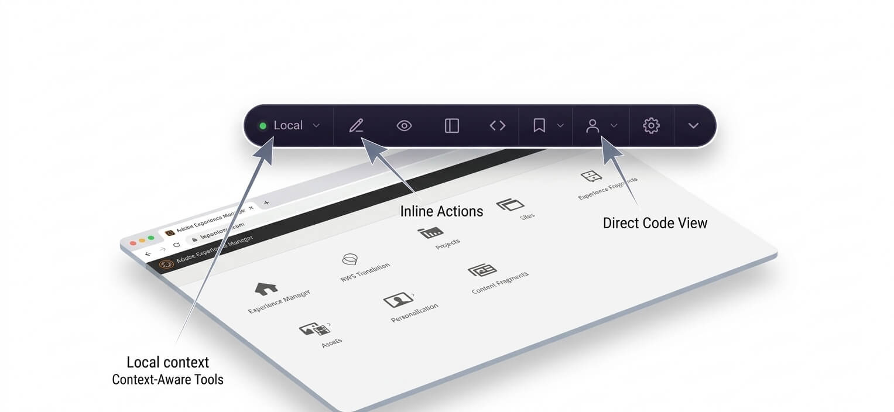
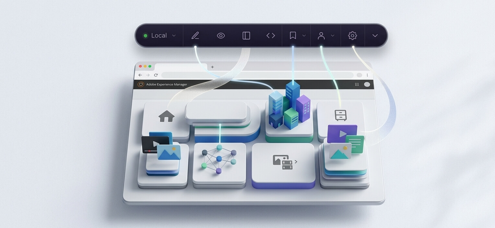

# Toolbar AEM Browser

A Chrome extension that adds a floating toolbar to Adobe Experience Manager (AEM) pages, so you can jump between consoles and environments without retyping URLs.



It works with any AEM project: AEM as a Cloud Service, AMS or on-premise, and a local SDK on `localhost:4502`. Environments, bookmarks and behaviour are all configured from the options page — nothing is tied to a specific project.

Plain JavaScript, Manifest V3, no build step and no dependencies.

> **Not an Adobe product.** This is an independent, community-made tool. It is not affiliated with, endorsed by or supported by Adobe.

## Features

- **Console switching** — open the current page in the Editor, View (published-like, optionally with `wcmmode=disabled`), Sites or CRXDE with one click. The content path is kept.
- **Environment switching** — reopen the same console and content path on another environment (Local, Dev, QA, Stage, or whatever you define).
- **Favicon per environment** — each tab gets a coloured favicon, so you can tell Stage from Local at a glance.
- **Bookmarks** — shortcuts to the paths you use most. A bare path opens on the current environment; a full URL opens as-is.
- **"Go to path" button** — adds a button next to Granite UI path fields that opens the typed path in the right console (Assets, Experience Fragments, Sites or CRXDE).
- **Import / export** — share your settings with your team as a JSON file.
- **Plugins** — ship project-specific bookmarks and console rules in a separate file, without touching the core.



## Install

The extension is not on the Chrome Web Store; load it unpacked:

1. Clone or download this repository.
2. Open `chrome://extensions` and turn on **Developer mode**.
3. Click **Load unpacked** and select the repository folder.
4. Click the extension icon to open the options page and set up your environments.

## Using the toolbar

From left to right:

| Control | What it does |
| --- | --- |
| Environment menu | Shows the current environment and lists the others. Picking one reopens the same console and content path there. |
| Edit, View, Sites, CRXDE | Open the current content path in that console. The button for the console you are already in is disabled. |
| Bookmarks | Your bookmarks, plus any plugin bookmarks. Each one opens in a new tab. Hidden when there are none. |
| Plugin links | Only shown when plugin bookmarks are set to use their own button. |
| Settings (gear) | Opens the options page. |
| Hide / Show (chevron) | Collapses the toolbar to a small tab and expands it again. |

Press `Esc` or click anywhere on the page to close an open menu.

A few behaviours worth knowing:

- On AEM as a Cloud Service the toolbar builds the unified shell URLs (`/ui#/aem/editor.html/...`); elsewhere it uses the classic ones (`/editor.html/...`).
- When you switch environment from a console other than those four (Assets, Projects, ...), the current URL is kept if both environments are of the same kind — both Cloud Service, or both not. Otherwise the target environment opens on its home page.
- The toolbar does not show in automated browsers (Lighthouse, WebDriver), so it never ends up in audits or test screenshots.

## Configure

Open the options page from the extension icon or from the gear button on the toolbar. After saving, reload your AEM tabs to apply the changes.

### Environments

Each environment has a colour, a name and an author URL. The URL must be `http` or `https`, and only its origin is used (scheme, host and port).

The toolbar shows up on:

- `localhost`
- `adobeaemcloud.com` and `aemcloud.net` hosts, including their subdomains
- the exact host of every environment you have configured

So for AMS or on-premise instances, adding the environment is all it takes for the toolbar to appear there.

### Toolbar

| Setting | What it does |
| --- | --- |
| Show the toolbar | Turn off to keep only the favicon per environment. |
| Change the favicon per environment | Replaces the tab favicon with the environment's one. |
| Start collapsed | Loads the toolbar minimised. |
| Open CRXDE in a new tab | Otherwise CRXDE replaces the current tab. |
| Disable WCM mode in View URLs | Adds `?wcmmode=disabled` when opening View. |
| "Go to path" button on path fields | Adds the shortcut button next to Granite UI path pickers. |
| Position | Bottom centre or top centre of the page. |
| Visible buttons | Pick which of Edit, View, Sites, CRXDE and Bookmarks are shown. |

### Bookmarks

Add a label and either a path (`/assets.html/content/dam/my-site`) or a full URL. Paths are appended to the origin of the tab you are on, so the same bookmark works on every environment.

### Save, reset, import and export

| Button | What it does |
| --- | --- |
| Save changes | Stores the environments, toolbar settings and bookmarks. Environments with an invalid URL are highlighted and nothing is saved until they are fixed. |
| Reset to defaults | Replaces everything with the values from `default-config.json`. |
| Export settings | Downloads `toolbar-aem-settings-YYYY-MM-DD.json` with your environments, toolbar settings and bookmarks. Plugin bookmarks are not included. |
| Import settings | Loads a previously exported file and replaces your current configuration. The file must contain at least one valid environment. |

### Defaults

The values used before anything is saved — and restored by **Reset to defaults** — live in [default-config.json](default-config.json). The Dev, QA and Stage environments in it are placeholders: replace them from the options page, or edit the file to ship the extension to your team with your own environments, bookmarks and console rules already in place.

Do not put anything confidential in `default-config.json`. Like the bundled favicons, it is a web-accessible resource, so a web page that knows the extension's ID can read it.

Favicons for the environment ids `local`, `dev`, `qa` and `stage` are bundled. Any other environment gets a generated favicon: its colour with the first two characters of its name.

To bundle your own favicon for an environment, add the image to the repository, map the environment id to the file name under `bundledFavicons` in `default-config.json`, and list the file under `web_accessible_resources` in `manifest.json`.

## Plugins

A plugin is a JavaScript file that registers project-specific bookmarks and console rules. Plugin bookmarks are always shown and cannot be edited from the options page, which makes them a good fit for links a whole team should share.

1. Create `plugins/my-project.js`:

   ```js
   registerAemToolbarPlugin({
     id: "my-project",
     favorites: [
       { label: "Content Fragments", path: "/assets.html/content/dam/my-site/content-fragments" },
       { label: "Experience Fragments", path: "/aem/experience-fragments.html/content/experience-fragments/my-site" }
     ],
     consoleRules: [
       { match: "/content-fragments/", console: "/editor.html" }
     ]
   });
   ```

2. Load it after `config.js` and before `index.js` in [manifest.json](manifest.json):

   ```json
   "js": ["config.js", "plugins/my-project.js", "index.js"]
   ```

3. Load it in [options.html](options.html) too, after `config.js`:

   ```html
   <script src="plugins/my-project.js"></script>
   ```

4. Reload the extension in `chrome://extensions`.

**Console rules** decide where the "Go to path" button sends a path. If the path contains `match`, it opens `console` + path. Rules are checked before the built-in defaults:

| Path starts with | Opens in |
| --- | --- |
| `/content/dam/` | Assets (`/assets.html`) |
| `/content/experience-fragments/` | Experience Fragments (`/aem/experience-fragments.html`) |
| `/content/` | Sites (`/sites.html`) |
| anything else | CRXDE (`/crx/de/index.jsp#`) |

Console rules can also be set in the `consoleRules` array of `default-config.json`.

In the options page, **Plugin links** controls whether plugin bookmarks appear inside the Bookmarks menu or under their own toolbar button.

## Permissions and privacy

- `storage` — settings are saved with `chrome.storage.sync`, so they follow your Chrome profile.
- `<all_urls>` content script match — needed because your environments can live on any host. The content script is injected on every page, but it exits without touching the page unless the host is `localhost`, an AEM Cloud host or one of your configured environments.

No other permission is requested.

The extension collects no data, has no analytics and makes no network requests of its own. Everything it needs is in this repository: no CDNs, no remote fonts, no remote code. The interface uses your system fonts; the only bundled font is Cozette, used on the credits screen.

## Project structure

| File | Purpose |
| --- | --- |
| `manifest.json` | Extension manifest (Manifest V3). |
| `default-config.json` | Default environments, settings, bookmarks and console rules. |
| `config.js` | Loads and merges defaults, saved settings and plugins. Shared by the content script and the options page. |
| `index.js`, `style.css` | The toolbar: content script and its styles. |
| `options.html`, `options.js`, `options.css` | The options page. |
| `background.js` | Service worker; opens the options page. |
| `credits.js`, `credits.css` | Credits screen on the options page. |
| `fonts/` | Cozette, the font of the credits screen. |
| `plugins/` | Optional project-specific plugins. |

## About the project

Toolbar AEM Browser is a free, open-source tool made for the AEM developer and author community. It has no commercial purpose: it started as a way to save time on everyday AEM work, and it is shared in the hope that it will be useful to others.

It is a community project maintained in spare time and provided as-is, with no warranty or guaranteed support. Feedback and contributions are always welcome.

### Relationship with Adobe

This project has no connection with Adobe. It is not developed, sponsored, endorsed or supported by Adobe, and it does not include any Adobe code. It only adds a toolbar to the pages of AEM instances you already have access to.

Adobe, Adobe Experience Manager and AEM are trademarks of Adobe Inc. They are used here only to describe what the extension works with.

## Contributing

Issues and pull requests are welcome. There is nothing to build: edit the files, reload the extension in `chrome://extensions` and reload your AEM tab.

Keep project-specific paths and URLs out of the core files — they belong in a plugin or in `default-config.json`.

## Credits

Created by Nando Muñoz.

## License

Released under the [MIT License](LICENSE). You are free to use, modify and distribute it, including in commercial projects, as long as the copyright notice is kept.
